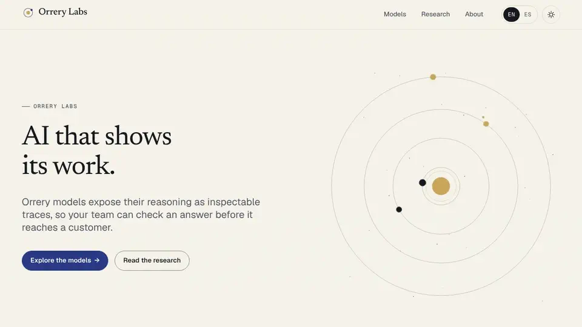
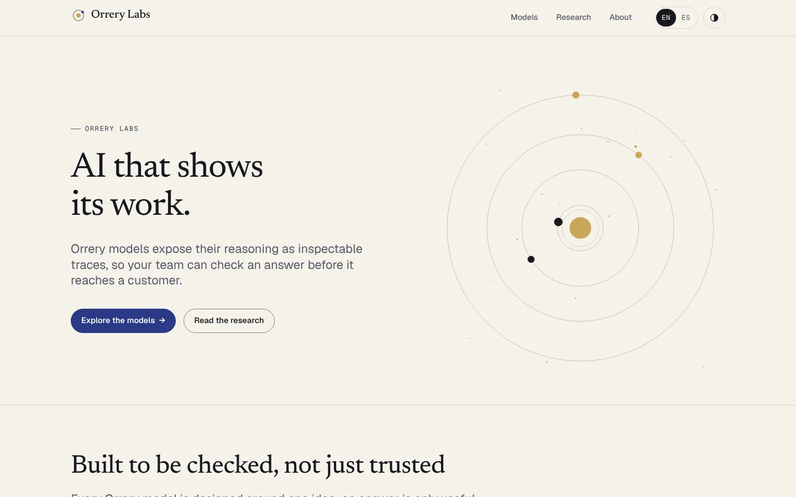
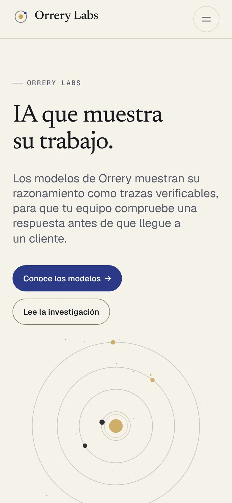
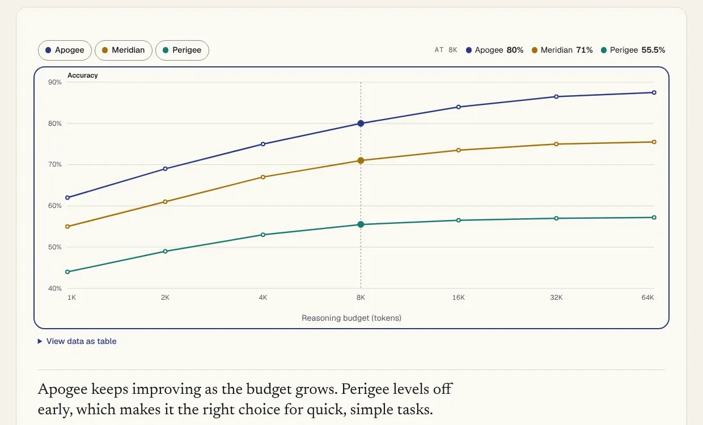
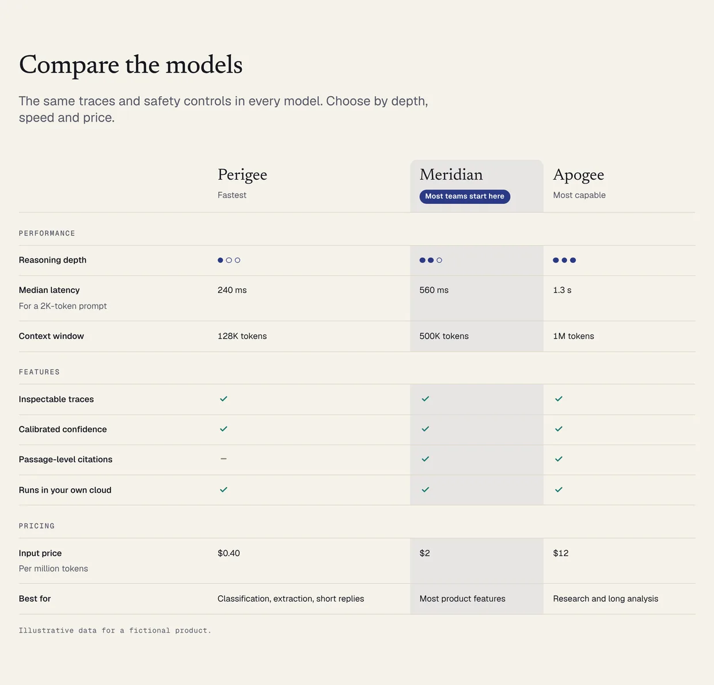
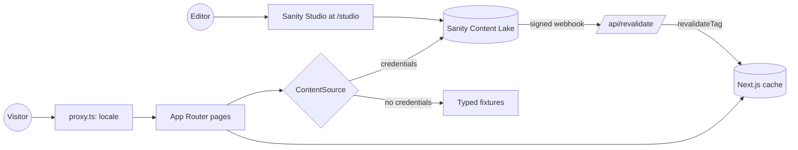

# Orrery Labs

[](https://github.com/RodionSorokin1993/orrery-web/actions/workflows/ci.yml)
[](https://orrery-web-topaz.vercel.app)
[](lighthouserc.json)
[](LICENSE)

A production-style marketing site for a fictional AI lab, built to show how I approach frontend
work: Next.js 16 with Cache Components, a headless CMS, English and Spanish, an accessible chart
without a chart library, and CI that blocks accessibility, layout and performance regressions.

**[Live site](https://orrery-web-topaz.vercel.app)** · [5-minute code tour](#a-5-minute-code-tour) ·
[Decisions](docs/decisions) · [Specs](docs/specs) ·
[A bug, start to finish](docs/postmortems/2026-11-26-sideways-scroll.md)



> Orrery Labs is not a real company. The brand, the people and every number on the site are
> invented for this portfolio project.

| Light theme                                           | Spanish, on a phone                                          |
| ----------------------------------------------------- | ------------------------------------------------------------ |
|  |  |

## Highlights

- **Headless CMS, modeled as code.** Pages are built from seven typed blocks (hero, feature
  grid, interactive chart, comparison table, stats, rich text, call to action). The Sanity schema
  lives in this repo with validation, previews and an embedded Studio at `/studio`.
- **Runs with zero setup.** Without Sanity credentials the site renders typed fixture content, so
  anyone can clone and run it. Add a project id and the same code reads from Sanity.
- **Next.js 16, the current way.** Cache Components with `'use cache'`, tagged cache entries and a
  signed Sanity webhook that expires only the documents that changed. Draft Mode for previews.
- **Localization.** `en` and `es` with localized slugs, `hreflang` alternates, a locale switcher that
  keeps the reader on the translated document, and `proxy.ts` negotiation by cookie and
  `Accept-Language`.
- **An accessible chart, without a chart library.** Scales, ticks and hit testing are small pure
  functions. The plot works with a mouse, a keyboard and a screen reader, and ships its data as a
  real table.
- **A comparison table that works on a phone.** The header row sticks on desktop; on small
  screens the table scrolls sideways with its labels pinned. Scroll shadows are CSS scroll-driven
  animations, and the block ships no client JavaScript.
- **Generative design.** Every page gets its own orrery, generated from a seed and rendered as SVG.
  The same generator draws the Open Graph image for each route.
- **Internal tooling.** One set of Content QA rules (broken links, missing translations, SEO
  lengths, chart data) runs in the Studio for editors and in CI for engineers.
- **Spec-driven development.** Every feature started as a spec in [`docs/specs`](docs/specs), and
  every acceptance criterion points to the test that proves it.

## A 5-minute code tour

If you only have a few minutes, these files show the most:

1. [`LineChart.tsx`](src/blocks/ChartBlock/LineChart.tsx): an interactive chart with no chart
   library. Arrow keys, Home and End move between points, a live region reads the values, and the
   same data is available as a table.
2. [`scales.ts`](src/lib/chart/scales.ts): the chart's math as small pure functions (nice ticks,
   linear and log scales, nearest-point lookup), with [tests](src/lib/chart/scales.test.ts).
3. [`source-types.ts`](src/content/source-types.ts): one interface for content. The site runs on
   typed fixtures with zero setup and on Sanity when credentials exist.
4. [`content/index.ts`](src/content/index.ts) and [`api/revalidate`](src/app/api/revalidate/route.ts):
   Cache Components in practice. Every reader is cached with fine-grained tags, and a signed
   webhook expires only what changed.
5. [`negotiate.ts`](src/lib/i18n/negotiate.ts) and [`proxy.ts`](src/proxy.ts): locale negotiation
   by cookie, then `Accept-Language` with quality weights, as a pure and tested function.
6. [`rules.ts`](src/content-qa/rules.ts): cross-document content checks written once and run in
   two places, the Studio and CI.
7. [`Comparison/`](src/blocks/Comparison): a responsive table with no client JavaScript, sticky on
   desktop, with pinned labels and scroll-driven shadows on phones.
8. [`e2e/`](e2e) and [`lighthouserc.json`](lighthouserc.json): the quality gates. axe on key pages,
   no sideways scroll on phones, the theme kept across navigation, and Lighthouse budgets.





## Engineering decisions

Short records of what I chose, what else I considered and what it costs:

- [Content comes through one interface, fixtures or CMS](docs/decisions/0001-content-behind-an-interface.md)
- [Cache everything, expire by tag from a signed webhook](docs/decisions/0002-cache-components-and-tags.md)
- [Build the chart on small pure functions, not a library](docs/decisions/0003-chart-without-a-chart-library.md)
- [CSS Modules and design tokens instead of Tailwind](docs/decisions/0004-css-modules-and-tokens.md)
- [One document per language, with localized slugs](docs/decisions/0005-document-level-translations.md)
- [Specs first, AI drafts, a human reviews](docs/decisions/0006-spec-driven-development-with-ai.md)

When something breaks in production, it gets a short postmortem:
[the models page scrolled sideways on phones](docs/postmortems/2026-11-26-sideways-scroll.md).

## Quality

| Check                    | Result                                                                |
| ------------------------ | --------------------------------------------------------------------- |
| Lighthouse (mobile)      | Performance 97 to 100, Accessibility 100, Best practices 100, SEO 100 |
| Unit and component tests | 66 tests with Vitest and Testing Library                              |
| End-to-end tests         | 42 Playwright tests: axe and a no-sideways-scroll check on six pages  |
| Content QA               | 0 errors, 0 warnings on the demo content                              |

CI runs lint, types, formatting, content QA, unit tests, a production build, end-to-end tests and
Lighthouse CI with budgets ([`lighthouserc.json`](lighthouserc.json)) on every pull request.

## Tech stack

Next.js 16 (App Router, Cache Components, Turbopack), React 19, TypeScript, Sanity 6 with
`next-sanity`, CSS Modules with design tokens, Vitest, Testing Library, Playwright, axe-core,
Lighthouse CI, GitHub Actions.

## Getting started

Requirements: Node.js 22 (see `.nvmrc`) and pnpm (`corepack enable` installs it).

```bash
pnpm install
pnpm dev
```

Open http://localhost:3000. You land on `/en` or `/es` depending on your browser language.

### Connect your own Sanity project (optional)

1. Create a free project at [sanity.io/manage](https://www.sanity.io/manage).
2. Copy `.env.example` to `.env.local` and set `NEXT_PUBLIC_SANITY_PROJECT_ID`.
3. In the project settings, add `http://localhost:3000` as a CORS origin with credentials.
4. Create an Editor token, put it in `SANITY_API_WRITE_TOKEN`, and copy the demo content:
   ```bash
   pnpm sanity:seed
   ```
5. Restart `pnpm dev` and open http://localhost:3000/studio.

For previews of unpublished drafts, add a Viewer token as `SANITY_API_READ_TOKEN`. For instant
updates after publishing, add a webhook in Sanity that calls `/api/revalidate` with the projection
`{_type, language, "slug": slug.current}` and the secret from `SANITY_REVALIDATE_SECRET`.

### Deploy

Import the repository in [Vercel](https://vercel.com/new). It deploys without any environment
variables using the demo content. Add the Sanity variables above to switch it to your CMS, and
set `NEXT_PUBLIC_SITE_URL` to the production URL for canonical links and the sitemap.

## Scripts

| Command              | What it does                                            |
| -------------------- | ------------------------------------------------------- |
| `pnpm dev`           | Site and Studio on http://localhost:3000                |
| `pnpm build`         | Production build                                        |
| `pnpm verify`        | Lint, types, content QA and unit tests                  |
| `pnpm test:e2e`      | Playwright and axe against a production build           |
| `pnpm content:check` | Content QA rules in the terminal, exit code 1 on errors |
| `pnpm lhci`          | Lighthouse CI with the budgets in `lighthouserc.json`   |
| `pnpm sanity:seed`   | Copy the demo content into your Sanity dataset          |

## Architecture



```
src/
  app/(site)/[lang]/   Localized routes, metadata, Open Graph images
  app/(studio)/        Embedded Sanity Studio with its own root layout
  app/api/             Draft Mode and the revalidation webhook
  blocks/              One folder per CMS block
  components/          Layout, navigation, typography, generative art
  content/             Domain types, fixtures, the ContentSource interface and cached readers
  content-qa/          Content QA rules, shared by the Studio tool and the CLI
  lib/                 i18n, chart scales, generative art, SEO helpers
  sanity/              Schema, desk structure, Studio tool, client
  styles/              Design tokens and global styles
docs/specs/            Specs written before the code
e2e/                   Playwright tests
```

## How this was built

I work with spec-driven development: a Markdown spec with requirements, acceptance criteria,
edge cases and what must not be touched comes first; an AI agent drafts a plan from it, I review
the plan, and the implementation is checked step by step against the spec with tests. The specs
for this project are in [`docs/specs`](docs/specs), and [`AGENTS.md`](AGENTS.md) describes the
workflow for coding agents.

## Roadmap

- Sanity Live and Visual Editing overlays in the Presentation tool
- Typed GROQ results with Sanity TypeGen
- View Transitions between pages
- More blocks: pricing, FAQ with structured data

## License

MIT for the code. Fonts are licensed under the SIL Open Font License. Release notes are in the
[changelog](CHANGELOG.md).
Designed and built by [Rodion Sorokin](https://www.linkedin.com/in/rodion-sorokin-1a4bb2178/).
