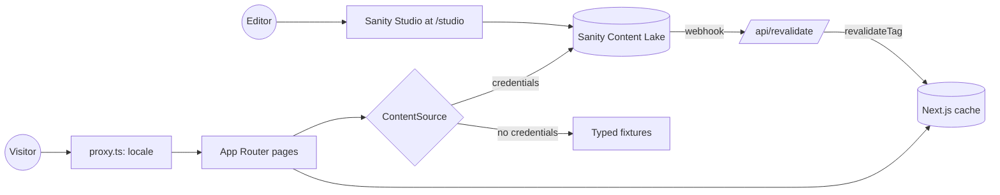

# 000: Overview and architecture

- **Status:** Implemented
- **Owner:** Rodion Sorokin

## Context

Orrery Labs is a **fictional** AI company. This repository is its marketing site: a Next.js
front end backed by a Sanity headless CMS. The project exists to show how a production
marketing site is built end to end: content modeling, page building from CMS blocks,
localization, interactive data visualization, programmatic design, internal tooling for
editors, and the quality gates that keep all of it fast and accessible.

## Goals

- Editors can build and publish pages from reusable blocks without a developer.
- Every page is statically rendered, fast on a mid-range phone, and accessible.
- The site runs out of the box with **no accounts and no secrets**: without Sanity credentials
  it renders typed fixture content, so anyone can clone it and run it.
- The same code reads from Sanity as soon as credentials are provided.

## Non-goals

- Authentication, user accounts, e-commerce.
- A real product or real benchmark data. All numbers on the site are illustrative.

## Requirements

- **R1.** Routes are localized under `/{locale}` (`en`, `es`). See [002](./002-i18n.md).
- **R2.** Pages are composed from typed blocks defined once in the content model. See [001](./001-content-model.md).
- **R3.** Content is read through a single `ContentSource` interface with two implementations:
  `fixtures` (default) and `sanity` (when `NEXT_PUBLIC_SANITY_PROJECT_ID` is set).
- **R4.** All content reads are cached with Cache Components (`'use cache'`) and tagged, so a
  Sanity webhook can revalidate exactly the documents that changed.
- **R5.** Draft Mode bypasses the cache and reads drafts, so editors can preview unpublished changes.
- **R6.** The embedded Sanity Studio lives at `/studio` and never ships to visitors of the site.
- **R7.** Client JavaScript is limited to interactive islands: chart, theme toggle, mobile
  navigation and locale switcher.
- **R8.** The reader's theme choice (system, light or dark) survives page loads and client
  navigation, a language switch included, with no flash of the other theme.

## Acceptance criteria

| ID  | Criterion                                           | Verified by        |
| --- | --------------------------------------------------- | ------------------ |
| AC1 | A dark theme choice survives switching the language | `e2e/site.spec.ts` |

## Routes

| Route                         | Source                        | Rendering               |
| ----------------------------- | ----------------------------- | ----------------------- |
| `/`                           | `proxy.ts` redirect           | Redirect to best locale |
| `/{locale}`                   | `page` with slug `home`       | Static, tagged cache    |
| `/{locale}/{slug}`            | `page` documents              | Static, tagged cache    |
| `/{locale}/blog`              | `post` collection             | Static, tagged cache    |
| `/{locale}/blog/{slug}`       | `post` documents              | Static, tagged cache    |
| `/studio`                     | Embedded Sanity Studio        | Client only             |
| `/api/draft-mode/*`           | Enable and disable Draft Mode | Route handlers          |
| `/api/revalidate`             | Sanity webhook                | Route handler, signed   |
| `/sitemap.xml`, `/robots.txt` | Metadata routes               | Static                  |

## Architecture

## Key decisions

- **Sanity over other CMSs:** the schema is TypeScript in this repo, so content modeling is
  reviewed like code. The Studio is embedded, so there is one deployment.
- **CSS Modules + design tokens over a utility framework:** layout, motion and theming are
  written in modern CSS (custom properties, container queries, `:has()`, scroll-driven
  animation with fallbacks). Tokens live in `src/styles/tokens.css`.
- **Fixtures as a first-class source:** they make CI deterministic, keep the demo working
  without accounts, and double as seed data (`pnpm sanity:seed`).
- **No images from the CMS in v1:** all artwork is generated from a seed. See [004](./004-generative-design.md).

## Do not touch

- The `<!-- BEGIN:nextjs-agent-rules -->` block in `AGENTS.md`; `next dev` manages it.
